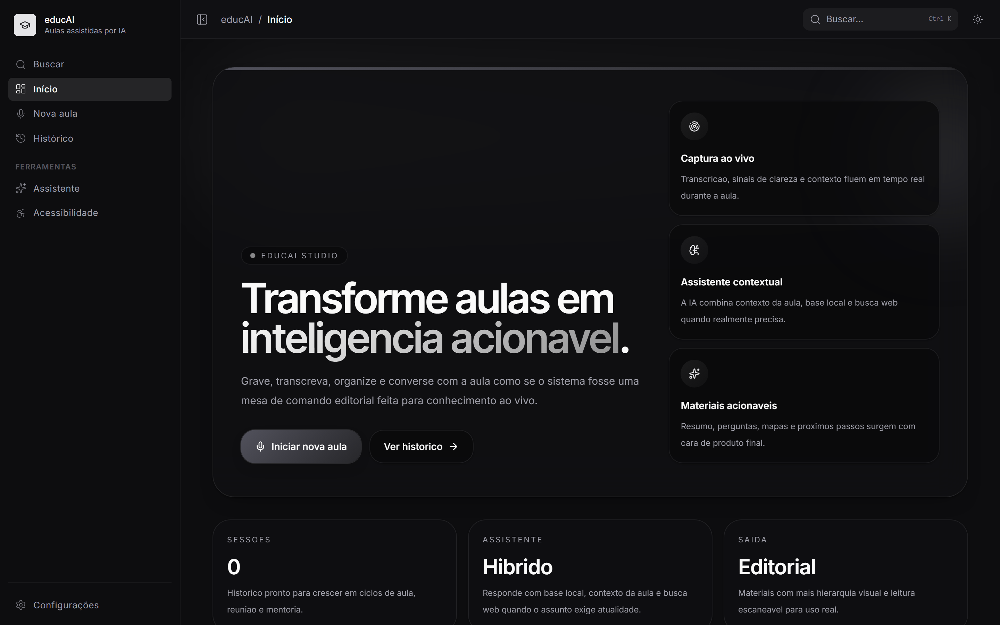
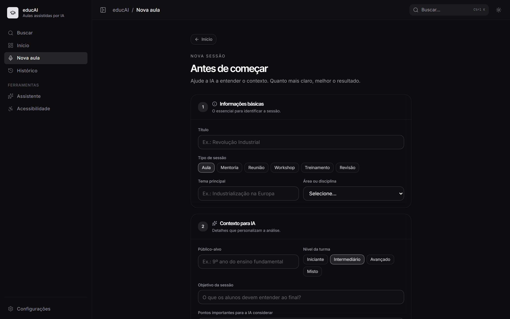
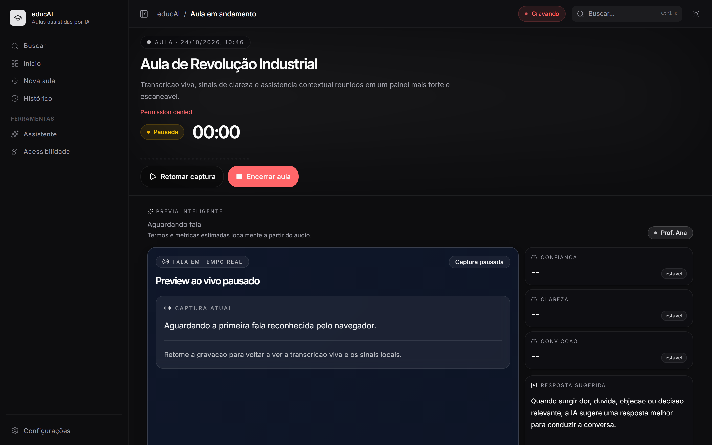
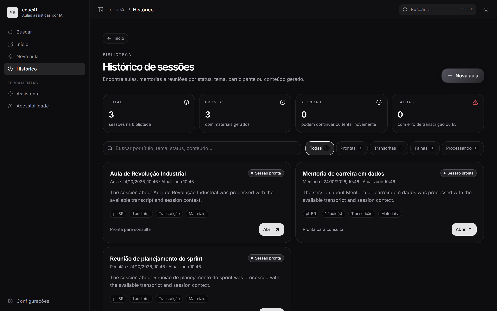
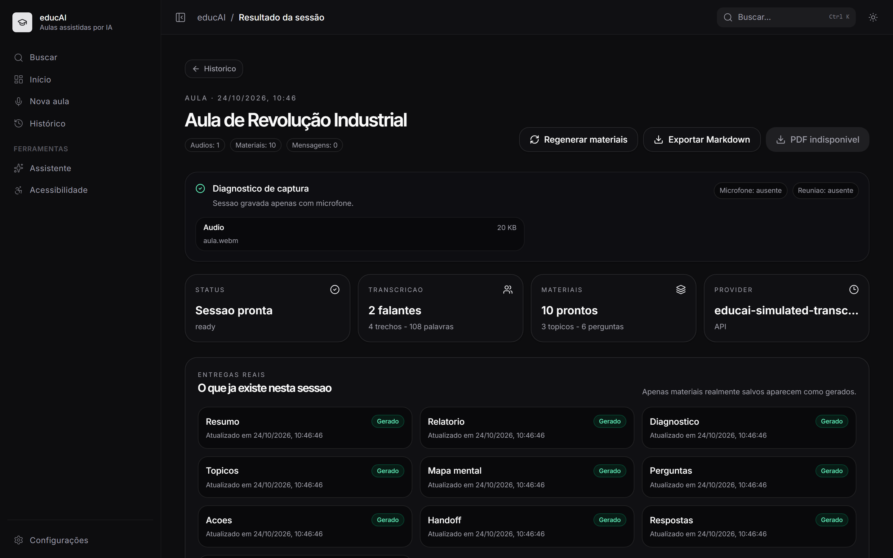
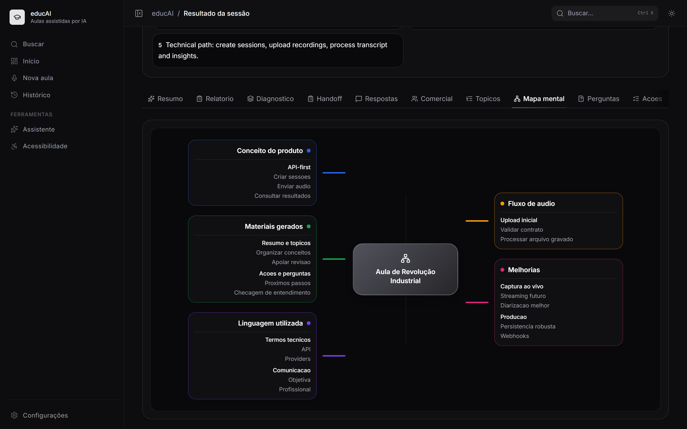
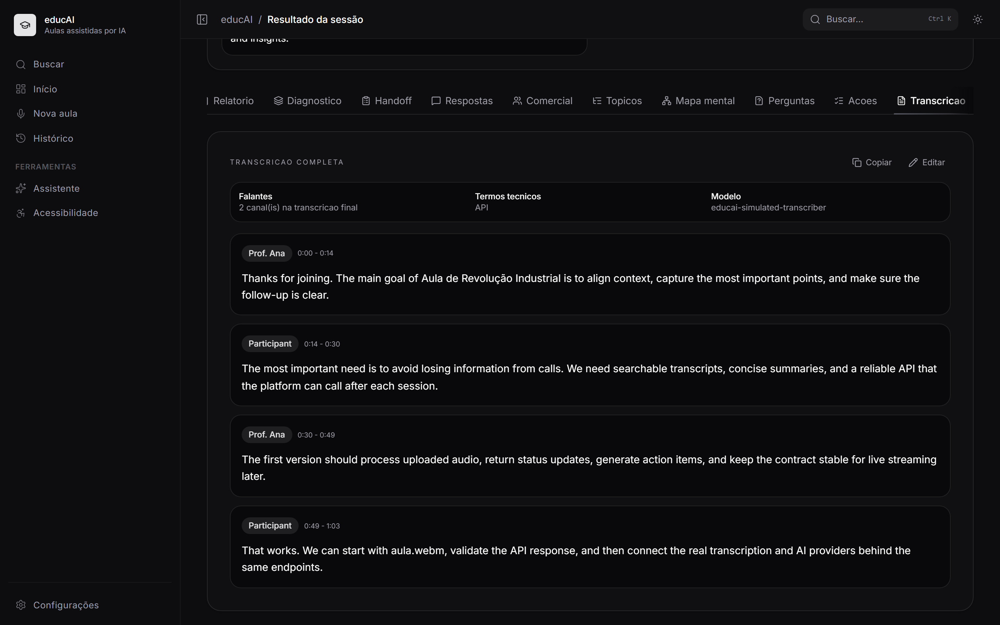
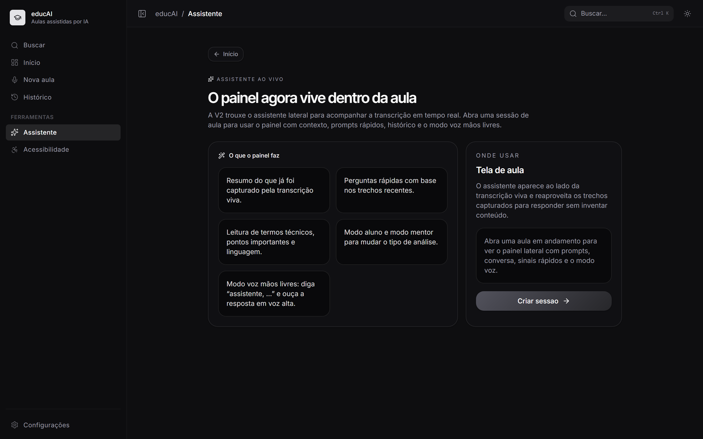
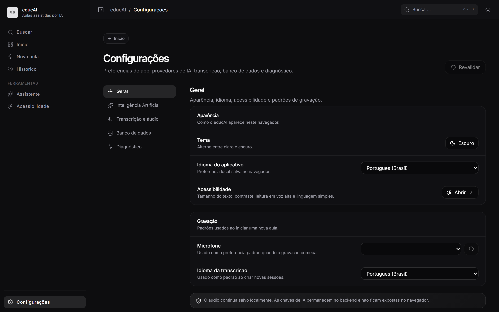
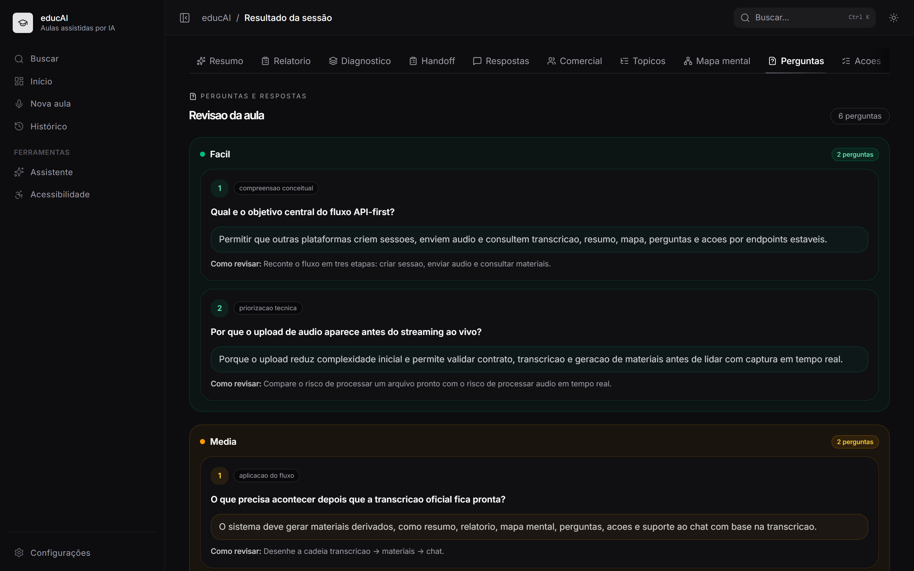

<div align="center">

# educAI

**Transforme aulas, reuniões e mentorias em conhecimento organizado.**

Aplicação com IA para gravar ou receber áudio/vídeo, transcrever o conteúdo e gerar
materiais de estudo, relatórios, mapas mentais, perguntas e próximos passos — tudo
conectado à sessão original.

[](https://react.dev/)
[](https://www.typescriptlang.org/)
[](https://tanstack.com/start)
[](https://vite.dev/)
[](https://tailwindcss.com/)
[](https://nodejs.org/)

[Telas](#-telas) · [Como usar](#-como-usar) · [Como rodar](#-como-rodar) · [Equipe](#-equipe) · [Documentação](#-documentação)

</div>

---

## 📌 Sobre o projeto

Muito conteúdo importante fica preso em gravações longas. Revisar uma aula, encontrar
uma decisão de reunião ou transformar uma conversa em material de estudo costuma dar
mais trabalho do que deveria.

O **educAI** resolve isso convertendo áudio em informação organizada e reutilizável:

```text
sessão → áudio/vídeo → transcrição → materiais → chat com IA → visão consolidada
```

O projeto não é limitado a professores. Ele pode ser usado em aulas, mentorias,
reuniões, treinamentos, consultorias, calls comerciais, workshops, apresentações e
atendimentos.

### Para quem é

- **Estudantes e professores:** registrar aulas, revisar tópicos e estudar com perguntas.
- **Mentores e mentorados:** guardar sessões e acompanhar recomendações e próximos passos.
- **Equipes:** documentar reuniões, treinamentos e workshops.
- **Consultores e profissionais comerciais:** rever atendimentos, apresentações e calls.

---

## ✨ Principais recursos

- Criação de sessões de vários tipos: aula, mentoria, reunião, treinamento, workshop,
  consultoria, call comercial e apresentação.
- **Gravação pelo navegador** ou **envio de um áudio/vídeo já pronto** na criação da aula.
- Prévia de transcrição ao vivo pela Web Speech API, quando o navegador oferece suporte.
- Indicadores locais durante a gravação: termos técnicos, pontos captados e alertas.
- Transcrição final segmentada, com revisão de texto e falantes.
- Geração de resumo, tópicos, relatório, mapa mental, perguntas e respostas, flashcards
  e itens de ação.
- Contexto da sessão (tema, público, nível, objetivos e instruções) para orientar a IA.
- Chat contextual sobre o conteúdo da sessão.
- Assistente ao vivo com modos Aluno e Mentor, perguntas sugeridas e interação por voz.
- Histórico com busca, filtros e status de processamento.
- Tela de resultado com visão executiva, transcrição, relatório, materiais e conversas.
- Exportação consolidada em Markdown.
- Configuração de providers com verificação de disponibilidade.
- Acessibilidade: menu rápido, guia de leitura, VLibras e anúncio de troca de tela.

> A prévia ao vivo e os indicadores locais são uma ajuda visual. A transcrição oficial
> é sempre a gerada a partir do áudio final enviado à IA.

---

## 📸 Telas

<div align="center">

| Início                                             | Nova aula                                          |
| -------------------------------------------------- | -------------------------------------------------- |
|  |  |

| Aula ao vivo                                     | Histórico                                          |
| ------------------------------------------------ | -------------------------------------------------- |
|  |  |

| Resultado                                          | Mapa mental                                               |
| -------------------------------------------------- | --------------------------------------------------------- |
|  |  |

| Transcrição                                                      | Assistente                                           |
| ---------------------------------------------------------------- | ---------------------------------------------------- |
|  |  |

| Configurações                                              | Perguntas e ações                                                    |
| ---------------------------------------------------------- | -------------------------------------------------------------------- |
|  |  |

</div>

---

## 🚀 Como usar

1. Crie uma conta ou entre em `/login`.
2. Vá em **Nova aula** e informe o título, o tipo da sessão e, se quiser, o contexto.
3. Escolha como o conteúdo será capturado:
   - **Gravar agora:** permita o microfone e grave a aula/reunião pelo navegador.
   - **Enviar arquivo:** selecione um áudio ou vídeo já gravado. O título é preenchido
     automaticamente com o nome do arquivo.
4. Ao finalizar (ou enviar o arquivo), a IA transcreve o conteúdo e gera os materiais.
5. Na tela de resultado, consulte o resumo, os tópicos, o mapa mental, as perguntas,
   as ações e o relatório.
6. Converse com o assistente para tirar dúvidas sobre a sessão.
7. Volte ao **Histórico** para reabrir qualquer sessão, buscar por conteúdo ou exportar
   em Markdown.

### Formatos aceitos no envio de arquivo

- **Áudio:** mp3, m4a, aac, wav, ogg, opus, flac, webm.
- **Vídeo:** mp4, m4v, mov, mkv, avi, mpeg, mpg.
- Limite padrão da API: **500 MB**.
- Arquivos acima de ~25 MB podem exceder o limite do provedor de IA. Para aulas longas,
  prefira enviar apenas o áudio.

---

## 🧰 Tecnologias

| Camada       | Tecnologias                                                   |
| ------------ | ------------------------------------------------------------- |
| Frontend     | React 19, TypeScript, TanStack Start, TanStack Router, Vite 7 |
| Estilo e UI  | Tailwind CSS 4, Radix UI, Lucide React, Recharts, GSAP        |
| Formulários  | React Hook Form e Zod                                         |
| Dados        | React Query e serviços HTTP próprios                          |
| Backend/API  | API V1 integrada ao servidor TanStack Start                   |
| IA           | OpenAI, Google Gemini, Ollama e Faster-Whisper                |
| Áudio        | Web Speech API, MediaRecorder e Web Audio API                 |
| Persistência | Arquivos locais em `.data/` ou Supabase (opcional)            |
| Qualidade    | Node.js test runner, ESLint e Prettier                        |

---

## 🖥️ Como rodar

Este guia mostra como rodar o projeto do zero, a partir do clone no GitHub.

### 1. Pré-requisitos

| Ferramenta                            | Versão                | Para quê                                           |
| ------------------------------------- | --------------------- | -------------------------------------------------- |
| [Git](https://git-scm.com/downloads)  | qualquer recente      | clonar o repositório                               |
| [Node.js](https://nodejs.org/)        | 22 LTS (mínimo 20.19) | rodar o app e os testes                            |
| npm                                   | vem com o Node        | instalar dependências                              |
| Chrome ou Edge                        | recente               | gravação, prévia ao vivo e captura de áudio de aba |
| [Ollama](https://ollama.com/download) | opcional              | gerar materiais e chat com IA local                |

Confira as versões:

```powershell
git --version
node -v
npm -v
```

### 2. Clonar o repositório

```powershell
git clone https://github.com/gustavoAbramo/educAI.git
cd educAI
```

### 3. Instalar as dependências

```powershell
npm install
```

> No PowerShell, se aparecer erro de política de execução de scripts, use
> `npm.cmd install` (e `npm.cmd run ...` nos demais comandos).

### 4. Escolher o provider de IA

O app precisa de um provider para **transcrição** e outro para **geração**
(materiais, chat e assistente). Não é obrigatório criar um arquivo `.env`: a
configuração pode ser feita por variáveis de ambiente no terminal ou pela tela
**Configurações** do próprio app.

Sem nenhuma configuração, a escolha é automática:

1. com `OPENAI_API_KEY` → usa OpenAI;
2. sem OpenAI, mas com `GEMINI_API_KEY` → usa Gemini;
3. sem nenhuma chave → usa Faster-Whisper (transcrição) e Ollama (geração), ambos locais.

Escolha **uma** das opções abaixo.

#### Opção A — Gemini ou OpenAI (mais simples para uso real)

Defina a chave no mesmo terminal em que vai subir o app:

```powershell
# Gemini
$env:GEMINI_API_KEY = "sua-chave"

# ou OpenAI
$env:OPENAI_API_KEY = "sk-..."
```

As variáveis `$env:` valem só para aquela janela do terminal. Como alternativa,
suba o app sem chave e cadastre-a em **Configurações**; ela fica salva criptografada
na pasta `.data/`.

#### Opção B — Modo simulado (só para conhecer as telas)

Não precisa de chave nem de IA instalada. Transcrição e materiais são textos de exemplo.

```powershell
$env:EDUCAI_ENABLE_SIMULATED_PROVIDERS = "true"
$env:EDUCAI_TRANSCRIPTION_PROVIDER = "mock"
$env:EDUCAI_AI_PROVIDER = "mock"
```

#### Opção C — Tudo local (Ollama + Faster-Whisper)

**Geração com Ollama**

1. Instale o Ollama e deixe-o rodando (`http://localhost:11434`).
2. Baixe o modelo padrão do projeto:

   ```powershell
   ollama pull qwen3:8b
   ```

   Para usar outro modelo, defina `OLLAMA_MODEL` ou troque em **Configurações**.

**Transcrição com Faster-Whisper**

O repositório traz apenas o worker HTTP que faz a ponte (`workers/faster-whisper-local`).
Em um segundo terminal:

```powershell
npm run dev:faster-whisper-worker
```

Ele sobe em `http://127.0.0.1:8765`. Por padrão o worker roda em modo `mock`, e o app
**recusa** transcrição simulada como resultado oficial. Para transcrição local de
verdade é preciso ter um serviço Faster-Whisper próprio rodando e apontar o worker
para ele antes de iniciá-lo:

```powershell
$env:FASTER_WHISPER_WORKER_BACKEND = "command"
$env:FASTER_WHISPER_COMMAND = "node --import tsx workers/faster-whisper-local/command-bridge.ts"
$env:FASTER_WHISPER_BRIDGE_BACKEND = "http"
$env:FASTER_WHISPER_BRIDGE_TRANSCRIBE_URL = "http://127.0.0.1:9000/transcribe"
npm run dev:faster-whisper-worker
```

Detalhes do contrato e da diarização em
[`workers/faster-whisper-local/README.md`](workers/faster-whisper-local/README.md).

### 5. Subir o app

```powershell
npm run dev
```

Frontend e API sobem juntos em `http://localhost:8080`.

Na primeira vez que alguém entra ou se cadastra, o servidor gera a chave das sessões
e a salva em `.data/auth-secret`. Para usar uma chave sua, por exemplo em produção,
defina `EDUCAI_AUTH_JWT_SECRET` no ambiente do servidor.

Abra `http://localhost:8080/cadastro` ou acesse **Cadastre-se** em
`http://localhost:8080/login`. Cada pessoa cria sua conta com e-mail e senha e entra
automaticamente. O cookie de sessão dura quatro horas.

A aplicação salva os hashes das senhas em `.data/accounts/` por padrão. Mantenha esse
diretório fora de `public/`. Para servidores sem disco persistente, use o
[armazenamento de contas no Supabase](docs/supabase-persistence.md#contas-de-usuário).
Guarde a chave JWT no ambiente do servidor para manter as sessões entre reinícios e
use HTTPS em produção.

<details>
<summary><strong>Configurar uma conta de administração (opcional)</strong></summary>

Se você já configurou `EDUCAI_AUTH_EMAIL` e `EDUCAI_AUTH_PASSWORD_HASH`, continue
usando essas credenciais. Essa conta administra os provedores e mantém o acesso às
aulas existentes que ainda não têm um dono.

Para configurá-la do zero, rode os comandos abaixo antes de iniciar o app:

```powershell
$env:EDUCAI_AUTH_EMAIL = Read-Host 'E-mail da conta'
$senha = Read-Host 'Senha da conta' -AsSecureString
$env:EDUCAI_AUTH_SETUP_PASSWORD = [System.Net.NetworkCredential]::new('', $senha).Password
try {
    $env:EDUCAI_AUTH_PASSWORD_HASH = @'
const { randomBytes, scryptSync } = require("node:crypto");
const password = process.env.EDUCAI_AUTH_SETUP_PASSWORD;
if (!password || password.length > 256) throw new Error("Informe uma senha de 1 a 256 caracteres.");
const salt = randomBytes(16);
const hash = scryptSync(password, salt, 32, {
  N: 2 ** 15, r: 8, p: 3, maxmem: 48 * 1024 * 1024,
});
console.log(`scrypt:${salt.toString("hex")}:${hash.toString("hex")}`);
'@ | node
} finally {
    Remove-Item Env:EDUCAI_AUTH_SETUP_PASSWORD
    $senha.Dispose()
}
```

</details>

### 6. Conferir se está funcionando

1. Entre com sua conta ou cadastre-se. A conta de administração pode conferir os
   provedores em **Configurações**.
2. Vá em **Nova aula**, crie uma sessão e permita o microfone — ou envie um áudio/vídeo.
3. Grave alguns segundos (ou escolha um arquivo) e finalize.
4. Aguarde a tela de processamento chegar ao resultado, com transcrição e materiais.

Para gravar reuniões do Meet/Teams, siga
[`docs/meeting-audio-checklist.md`](docs/meeting-audio-checklist.md).

---

## 📁 Estrutura do projeto

```text
src/
  routes/       rotas finas do TanStack Router
  features/     telas por domínio (nova-aula, aula, resultado, histórico…)
  services/     cliente HTTP da API V1
  server/       API, providers de IA e persistência
  lib/          lógica compartilhada e utilitários
workers/        worker local de transcrição Faster-Whisper
docs/           documentação técnica
apresentacao/   prints usados no README
```

A API V1 segue um contrato congelado em [`docs/api.md`](docs/api.md). O fluxo principal é:

```text
session → audio → status → transcript → materials → chat → overview
```

---

## ⌨️ Comandos úteis

| Comando                              | O que faz                               |
| ------------------------------------ | --------------------------------------- |
| `npm run dev`                        | sobe app + API em modo desenvolvimento  |
| `npm run dev:faster-whisper-worker`  | sobe o worker local de transcrição      |
| `npm test`                           | roda todos os testes                    |
| `npm run test:api`                   | roda só o teste de integração da API V1 |
| `npm run build`                      | gera o build de produção                |
| `npm run preview`                    | serve o build gerado                    |
| `npm run lint`                       | roda o ESLint                           |
| `npm run format`                     | formata o código com Prettier           |
| `node_modules\.bin\tsc.cmd --noEmit` | valida os tipos TypeScript              |

---

## 🔐 Variáveis de ambiente

Nenhuma variável é obrigatória para entrar e criar contas. As variáveis abaixo ajustam
a configuração do servidor.

| Variável                                            | Padrão                        | Descrição                                                                   |
| --------------------------------------------------- | ----------------------------- | --------------------------------------------------------------------------- |
| `EDUCAI_AUTH_EMAIL`                                 | —                             | e-mail reservado para a conta de administração                              |
| `EDUCAI_AUTH_PASSWORD_HASH`                         | —                             | hash scrypt da conta de administração                                       |
| `EDUCAI_AUTH_JWT_SECRET`                            | gerada em `.data/auth-secret` | chave de 32 bytes em hexadecimal                                            |
| `EDUCAI_AUTH_SECRET_FILE`                           | `.data/auth-secret`           | onde salvar a chave gerada automaticamente                                  |
| `EDUCAI_AUTH_STORE`                                 | `local`                       | `local` ou `supabase` para guardar contas                                   |
| `EDUCAI_AUTH_ACCOUNTS_DIR`                          | `.data/accounts/`             | diretório persistente quando as contas são locais                           |
| `OPENAI_API_KEY`                                    | —                             | chave da OpenAI                                                             |
| `GEMINI_API_KEY`                                    | —                             | chave do Gemini                                                             |
| `EDUCAI_TRANSCRIPTION_PROVIDER`                     | automático                    | `mock`, `openai`, `gemini` ou `faster-whisper`                              |
| `EDUCAI_AI_PROVIDER`                                | automático                    | `mock`, `openai`, `gemini` ou `ollama`                                      |
| `EDUCAI_ENABLE_SIMULATED_PROVIDERS`                 | `false`                       | libera os providers `mock`                                                  |
| `EDUCAI_DEBUG_PROVIDERS`                            | `false`                       | loga no terminal qual provider foi escolhido                                |
| `EDUCAI_ASSISTANT_WEB_SEARCH`                       | `auto`                        | `auto`, `on` ou `off`                                                       |
| `OPENAI_TRANSCRIBE_MODEL` / `OPENAI_INSIGHTS_MODEL` | —                             | modelos da OpenAI                                                           |
| `GEMINI_TRANSCRIBE_MODEL` / `GEMINI_INSIGHTS_MODEL` | —                             | modelos do Gemini                                                           |
| `OLLAMA_BASE_URL`                                   | `http://localhost:11434`      | endereço do Ollama                                                          |
| `OLLAMA_MODEL`                                      | `qwen3:8b`                    | modelo do Ollama                                                            |
| `FASTER_WHISPER_BASE_URL`                           | `http://localhost:8765`       | endereço do worker de transcrição                                           |
| `FASTER_WHISPER_MODEL`                              | `small`                       | modelo do Faster-Whisper                                                    |
| `EDUCAI_PROVIDER_TIMEOUT_MS`                        | —                             | timeout das chamadas aos providers                                          |
| `EDUCAI_MAX_AUDIO_UPLOAD_BYTES`                     | 500 MiB                       | tamanho máximo de upload de áudio                                           |
| `EDUCAI_ALLOW_REMOTE_LOCAL_PROVIDERS`               | `false`                       | permite Ollama/Faster-Whisper fora da rede local                            |
| `EDUCAI_PERSISTENCE_PROVIDER`                       | `local`                       | `local` ou `supabase`                                                       |
| `SUPABASE_URL` / `SUPABASE_SERVICE_ROLE_KEY`        | —                             | usados quando a persistência é `supabase`                                   |
| `VITE_EDUCAI_API_BASE_URL`                          | `/api/v1`                     | endereço da API na mesma origem do frontend para receber o cookie de sessão |

> Nunca suba arquivos `.env` nem pastas `env/` para o repositório. Eles já estão
> protegidos pelo `.gitignore`.

---

## 💾 Onde os dados ficam

Por padrão tudo é salvo localmente na pasta `.data/`, criada automaticamente na raiz
do projeto e ignorada pelo Git:

- `voice-sessions.json` — sessões, transcrições e materiais;
- `recordings/` — áudios gravados e enviados;
- `settings.json` e `provider-settings.json` — configurações feitas pela tela;
- chaves cadastradas pela tela, criptografadas.

Apagar a pasta `.data/` zera o app. Para sincronizar sessões com o Supabase, veja
[`docs/supabase-persistence.md`](docs/supabase-persistence.md).

---

## 🛠️ Problemas comuns

| Sintoma                              | Causa provável e solução                                                                                  |
| ------------------------------------ | --------------------------------------------------------------------------------------------------------- |
| `npm` bloqueado no PowerShell        | política de execução; use `npm.cmd` no lugar de `npm`                                                     |
| A porta 8080 está ocupada            | encerre o processo que está usando a porta antes de iniciar o educAI                                      |
| Erro de transcrição indisponível     | provider selecionado sem chave, ou worker Faster-Whisper parado/em modo `mock`; confira **Configurações** |
| Materiais ou chat falham com Ollama  | Ollama não está rodando ou o modelo não foi baixado (`ollama pull qwen3:8b`)                              |
| Variável de ambiente "não pegou"     | `$env:` só vale na janela onde foi definida; defina e rode `npm run dev` no mesmo terminal                |
| Microfone não funciona               | permita o microfone no navegador e acesse por `localhost`                                                 |
| "Navegador sem captura de aba"       | use Chrome ou Edge                                                                                        |
| Arquivo enviado falha na transcrição | o arquivo pode ter passado do limite do provider; para aulas longas, envie só o áudio                     |

---

## 👥 Equipe

<table>
  <tr>
    <td align="center" width="200">
      <a href="https://github.com/gustavoAbramo">
        
        <br />
        <sub><b>Gustavo Abramo</b></sub>
      </a>
      <br />
      <sub>Desenvolvimento</sub>
    </td>
    <td align="center" width="200">
      <a href="https://github.com/Ruuan0liveira">
        
        <br />
        <sub><b>Ruan Oliveira</b></sub>
      </a>
      <br />
      <sub>Desenvolvimento</sub>
    </td>
  </tr>
</table>

---

## 📚 Documentação complementar

- [`AI_CONTEXT.md`](AI_CONTEXT.md) — contexto e decisões técnicas do projeto
- [`docs/api.md`](docs/api.md) — contrato da API V1 (congelado)
- [`docs/runtime-hardening.md`](docs/runtime-hardening.md) — limites e segurança do runtime
- [`docs/supabase-persistence.md`](docs/supabase-persistence.md) — persistência no Supabase
- [`docs/meeting-audio-checklist.md`](docs/meeting-audio-checklist.md) — captura de reuniões
- [`workers/faster-whisper-local/README.md`](workers/faster-whisper-local/README.md) — worker local de transcrição

---

<div align="center">

Feito com dedicação para transformar conversa em conhecimento.

</div>
